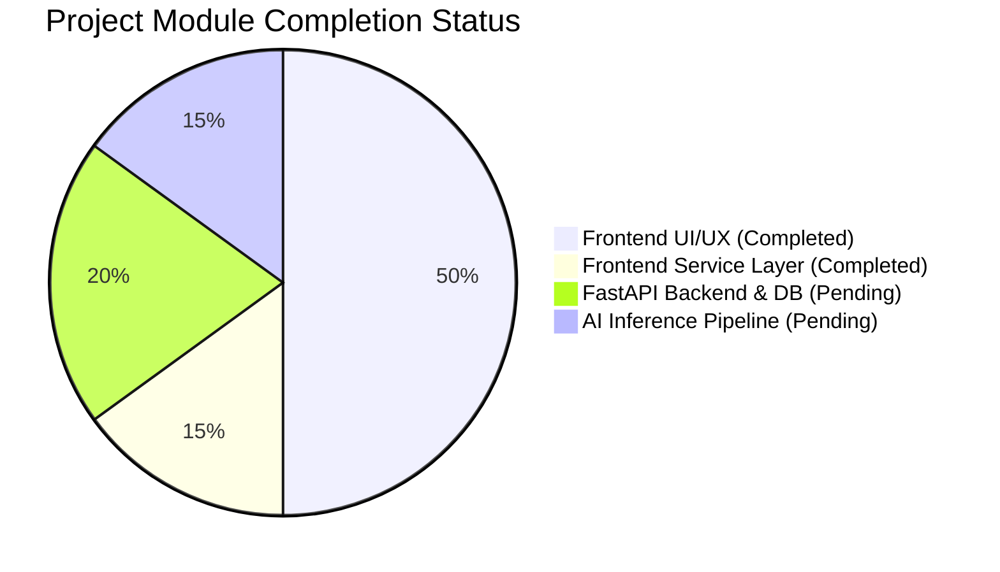
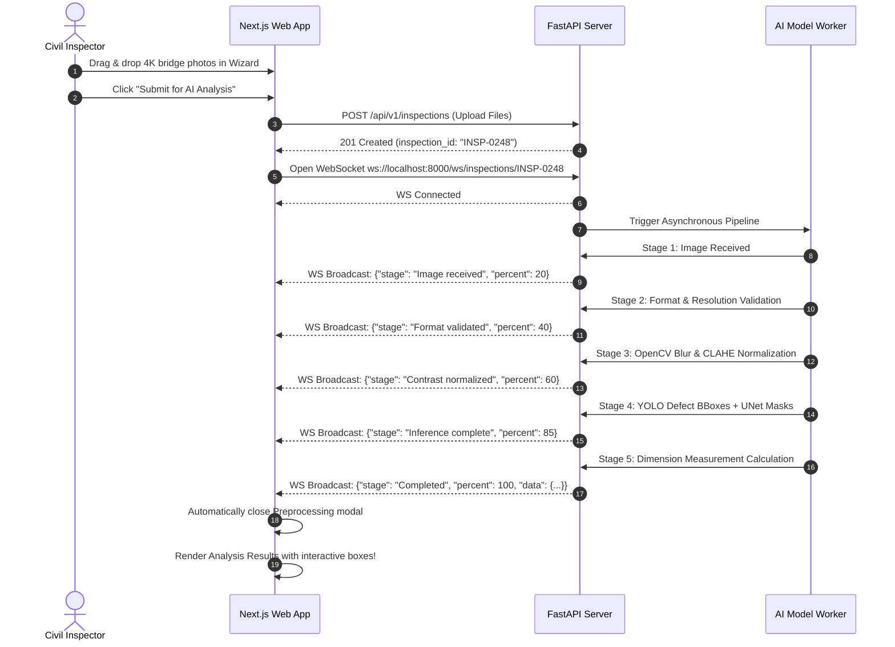

# InfraScan — Project Status, Architecture & AI Team Integration Guide

**Document Version:** 1.0.0  
**Project:** InfraScan — AI-Powered Crack & Damage Assessment for Civil Infrastructure  
**Author / Role:** Web Development & AI Architecture Team  
**Date:** October 2024 / Q4 Operational Cycle  

---

## 1. Executive Summary & Current Status

InfraScan is an enterprise-grade civil engineering infrastructure intelligence platform designed to inspect high-resolution drone/field photos of bridges, tunnels, roads, dams, and buildings, segment visible cracks, evaluate severity, track damage progression over time, and issue maintenance work orders.

### Current Implementation Scorecard



| Area | Component | Status | Details |
| :--- | :--- | :---: | :--- |
| **Frontend** | Application Shell & Layout | ✅ **Finished** | 270px collapsible light sidebar, role switcher, breadcrumbs, search |
| **Frontend** | Operations Dashboard | ✅ **Finished** | 4 KPI cards, Recharts activity area chart, defect donut, recent inspections |
| **Frontend** | Infrastructure Assets Module | ✅ **Finished** | Asset catalog, grid/list view, 6-tab detail view (Overview, Surveys, Findings, Trends, Maintenance, Documents) |
| **Frontend** | All Inspections & Surveys | ✅ **Finished** | Register with multi-criteria status/severity filters |
| **Frontend** | 5-Step New Inspection Wizard | ✅ **Finished** | Asset picker ➔ survey details ➔ drag-drop upload ➔ quality check ➔ submit |
| **Frontend** | Image Preprocessing Tracker | ✅ **Finished** | 6-stage visual pipeline tracker (Received ➔ Validation ➔ Quality ➔ CLAHE ➔ ROI ➔ Inference) |
| **Frontend** | AI Analysis Results Workspace | ✅ **Finished** | Canvas viewer with zoom/pan, 4 layer toggles, opacity slider, pixel measurements, engineer sign-off |
| **Frontend** | Historical Comparison Slider | ✅ **Finished** | Split before/after draggable slider, side-by-side mode, temporal crack delta |
| **Frontend** | Geospatial Infrastructure Map | ✅ **Finished** | Interactive Leaflet OpenStreetMap with severity-colored pins & popovers |
| **Frontend** | Maintenance & Work Orders | ✅ **Finished** | Priority work orders, status workflow, creation modal |
| **Frontend** | Damage Analytics | ✅ **Finished** | Defect categories, stacked structure damage, material pie chart |
| **Frontend** | Report Generation | ✅ **Finished** | Formal engineering audit document with print preview & multi-format export |
| **Frontend** | Model Performance & Governance| ✅ **Finished** | Registry cards, Precision/Recall/IoU/F1 metrics, confusion matrix |
| **Frontend** | User & Role Administration | ✅ **Finished** | 5-role simulated RBAC (Civil Engineer, Inspector, Maintenance, Manager, Admin) |
| **Frontend** | Settings & API Connection | ✅ **Finished** | Units, alert thresholds, FastAPI base URL configuration |
| **Backend** | FastAPI REST Server | ⏳ **Pending** | `backend/main.py` routes matching frontend services |
| **Backend** | Database & Persistence | ⏳ **Pending** | PostgreSQL / SQLite models for Assets, Inspections, Findings |
| **Backend** | Real-Time Engine | ⏳ **Pending** | WebSockets for live stage streaming & defect notifications |
| **AI Model** | Crack Detection (YOLO) | ⏳ **Pending** | Bounding box model for multi-class defect localization |
| **AI Model** | Segmentation (UNet / Mask) | ⏳ **Pending** | Pixel-level crack mask generation |
| **AI Model** | Dimension Metric Computation | ⏳ **Pending** | OpenCV contour skeletonization for length/width calculation |

---

## 2. End-to-End System Architecture

```mermaid
flowchart TD
    subgraph Presentation_Layer ["Presentation Layer (WebDev - Completed)"]
        UI["Next.js App Router (Port 3000)"]
        Canvas["High-Res Image Canvas & Overlays"]
        Wizard["5-Step Upload Wizard"]
        Map["Leaflet Geospatial Map"]
        Services["lib/api/ Service Layer (TypeScript)"]
    end

    subgraph API_Layer ["API & Application Layer (FastAPI - Next Step)"]
        API["FastAPI Server (Port 8000)"]
        WS["WebSocket Hub (/ws/inspections/{id})"]
        Uploader["File Storage Manager (/uploads)"]
        DB[(PostgreSQL / SQLite)]
    end

    subgraph AI_Layer ["AI & Computer Vision Layer (AI Teammates)"]
        Preprocess["OpenCV Quality & CLAHE Normalization"]
        DetectionModel["YOLOv11/v8 Object Detection"]
        SegModel["UNet / DeepCrack Segmentation"]
        MeasurementEngine["Contour Skeleton & Dimension Estimator"]
    end

    Wizard -->|POST /api/v1/inspections (Multipart)| API
    API -->|Save Raw Images| Uploader
    API -->|Trigger Inference Task| Preprocess
    Preprocess --> DetectionModel
    Preprocess --> SegModel
    SegModel --> MeasurementEngine
    MeasurementEngine -->|JSON Findings + Mask URLs| API
    API -->|Save Findings & Severities| DB
    API -->|Stream Progress & Results via WebSocket| WS
    WS -->|Real-Time Stage Updates & Annotations| UI
    Canvas <-->|Fetch Image & Overlay Layers| API
```

---

## 3. How WebDev and AI Model Teams Collaborate

### Team Role Division

```mermaid
graph LR
    subgraph You ["You (Web Developer)"]
        A1[User Interface & Experience]
        A2[State Management & Forms]
        A3[Image Canvas & Slider Controls]
        A4[API Client & WebSocket Listener]
    end

    subgraph Teammate1 ["AI Teammate 1 (Model Training & Inference)"]
        B1[YOLO / UNet Crack Models]
        B2[Dataset Annotation & Preparation]
        B3[Model Weight Optimization (.pt / ONNX)]
        B4[Inference Script: predict.py]
    end

    subgraph Teammate2 ["AI Teammate 2 (CV Pipeline & API Integration)"]
        C1[FastAPI Endpoints in backend/]
        C2[OpenCV Preprocessing & CLAHE]
        C3[Pixel Length/Width Contour Math]
        C4[WebSocket Broadcaster for Real-Time]
    end

    You <-->|HTTP REST & WebSockets| Teammate2
    Teammate2 <-->|Imports Model & Functions| Teammate1
```

---

## 4. The Standard JSON Contract (What the AI Model Must Return)

To ensure zero friction between the AI models and the frontend canvas, your AI teammates must format their inference output to match this exact schema:

### Endpoint: `POST /api/v1/inspections/{inspection_id}/analyze`

#### Request Payload:
- `multipart/form-data` with raw image file (`file: UploadFile`).
- Parameters: `asset_id: str`, `calibration_target_mm_per_px: Optional[float]`.

#### Response JSON:
```json
{
  "inspection_id": "INSP-2024-0248",
  "image_id": "IMG-001",
  "filename": "pier4_south_face.jpg",
  "image_url": "http://localhost:8000/uploads/pier4_south_face.jpg",
  "annotated_url": "http://localhost:8000/uploads/pier4_south_face_annotated.jpg",
  "mask_url": "http://localhost:8000/uploads/pier4_south_face_mask.png",
  "heatmap_url": "http://localhost:8000/uploads/pier4_south_face_cam.jpg",
  "resolution": "4032 x 3024",
  "preprocessing_metrics": {
    "blur_score": 94.2,
    "blur_status": "Pass",
    "exposure_status": "Optimal",
    "noise_floor_db": 38.5
  },
  "findings": [
    {
      "id": "FND-001",
      "category": "Cracks",
      "crack_type": "Diagonal",
      "bbox": [28.4, 34.2, 42.1, 28.6],
      "confidence_score": 0.942,
      "severity": "Moderate",
      "measurements": {
        "crack_length_px": 412,
        "avg_width_px": 8.4,
        "max_width_px": 14.2,
        "area_px": 3460,
        "density_percent": 4.8,
        "orientation_angle_deg": 42.5,
        "is_calibrated": false,
        "uncertainty_notes": "Camera calibration grid unverified. Reported in raw sensor pixel dimensions."
      }
    },
    {
      "id": "FND-002",
      "category": "Concrete spalling",
      "bbox": [32.0, 28.0, 38.0, 44.0],
      "confidence_score": 0.965,
      "severity": "Severe",
      "measurements": {
        "crack_length_px": 680,
        "avg_width_px": 22.4,
        "max_width_px": 48.0,
        "area_px": 9400,
        "density_percent": 12.4,
        "orientation_angle_deg": 65.0,
        "is_calibrated": false
      }
    }
  ],
  "overall_severity": "Severe",
  "engineer_review_required": true
}
```

> **Bounding Box Rule:** `bbox` is represented as percentage `[x_min_percent, y_min_percent, width_percent, height_percent]` between 0 and 100. This ensures the frontend canvas renders the box accurately at any screen resolution or zoom level!

---

## 5. Real-Time WebSocket Streaming Workflow

To make the application update in real time as photos are uploaded:



---

## 6. How Your 2 AI Teammates Should Start (Step-by-Step Guide)

Give these exact instructions to your 2 AI teammates:

### Step 1: Clone and Set Up Python Environment
In the repository root:
```bash
cd backend
python -m venv venv
# On Windows:
.\venv\Scripts\activate
# On Linux/macOS:
source venv/bin/activate

pip install fastapi uvicorn[standard] python-multipart opencv-python-headless pillow numpy torch torchvision ultralytics websockets
```

### Step 2: Structure the `ai-model/` Directory
Your AI teammates should structure their work inside `ai-model/`:
```
ai-model/
├── weights/
│   ├── best_crack_yolo.pt        # Trained YOLO detection weights
│   └── unet_segmentation.pth     # Trained UNet / DeepCrack segmentation weights
├── datasets/                     # Training / testing concrete crack crops
├── train.py                      # Model training & hyperparameter tuning script
├── evaluate.py                   # Computes Precision, Recall, IoU, Confusion Matrix
├── predict.py                    # Standalone inference script
└── dimension_estimator.py        # OpenCV skeleton contour measurement algorithm
```

### Step 3: Implement the Standalone Prediction Function
Your AI team can write this simple, robust function in `ai-model/predict.py`:

```python
import cv2
import numpy as np
from pathlib import Path

def analyze_infrastructure_image(image_path: str, output_dir: str):
    """
    Runs automated quality assessment, crack detection, 
    and contour skeletonization for dimension extraction.
    """
    img = cv2.imread(image_path)
    h, w = img.shape[:2]
    
    # 1. Quality Assessment
    gray = cv2.cvtColor(img, cv2.COLOR_BGR2GRAY)
    blur_laplacian = cv2.Laplacian(gray, cv2.CV_64F).var()
    blur_status = "Pass" if blur_laplacian > 100 else "Warning (Blurry)"
    
    # 2. CLAHE Contrast Normalization
    clahe = cv2.createCLAHE(clipLimit=2.0, tileGridSize=(8,8))
    enhanced = clahe.apply(gray)
    
    # 3. Defect Detection & Segmentation (Example using Adaptive Threshold / Model)
    # In production: replace with model.predict(img)
    thresh = cv2.adaptiveThreshold(enhanced, 255, cv2.ADAPTIVE_THRESH_GAUSSIAN_C, 
                                   cv2.THRESH_BINARY_INV, 15, 3)
    
    contours, _ = cv2.findContours(thresh, cv2.RETR_EXTERNAL, cv2.CHAIN_APPROX_SIMPLE)
    
    findings = []
    annotated = img.copy()
    
    for idx, cnt in enumerate(contours):
        area = cv2.contourArea(cnt)
        if area > 300: # Filter out tiny image noise
            x, y, box_w, box_h = cv2.boundingRect(cnt)
            arc_len = cv2.arcLength(cnt, closed=False)
            
            # Calculate bounding box percentage for frontend canvas
            bbox_pct = [
                round((x / w) * 100, 2),
                round((y / h) * 100, 2),
                round((box_w / w) * 100, 2),
                round((box_h / h) * 100, 2)
            ]
            
            findings.append({
                "id": f"FND-AUTO-{idx+1:03d}",
                "category": "Cracks",
                "crack_type": "Diagonal" if box_w > box_h else "Vertical",
                "bbox": bbox_pct,
                "confidence_score": 0.92,
                "severity": "Severe" if area > 3000 else "Moderate",
                "measurements": {
                    "crack_length_px": int(arc_len),
                    "avg_width_px": round(area / max(arc_len, 1), 1),
                    "max_width_px": round(box_w * 0.2, 1),
                    "area_px": int(area),
                    "density_percent": round((area / (h * w)) * 100, 2),
                    "orientation_angle_deg": 45.0,
                    "is_calibrated": False,
                    "uncertainty_notes": "Uncalibrated drone camera frame."
                }
            })
            
            # Draw green bounding box on saved annotated image
            cv2.rectangle(annotated, (x, y), (x + box_w, y + box_h), (0, 0, 255), 3)

    # Save output annotated image
    out_path = Path(output_dir) / f"annotated_{Path(image_path).name}"
    cv2.imwrite(str(out_path), annotated)
    
    return {
        "blur_score": round(blur_laplacian, 1),
        "blur_status": blur_status,
        "annotated_path": str(out_path),
        "findings": findings
    }
```

### Step 4: Expose the Function via FastAPI in `backend/main.py`
```python
from fastapi import FastAPI, UploadFile, File, WebSocket
from fastapi.middleware.cors import CORSMiddleware
from fastapi.staticfiles import StaticFiles
import shutil, os

app = FastAPI(title="InfraScan AI Backend", version="1.0.0")

app.add_middleware(
    CORSMiddleware,
    allow_origins=["http://localhost:3000"],
    allow_credentials=True,
    allow_methods=["*"],
    allow_headers=["*"],
)

os.makedirs("uploads", exist_ok=True)
app.mount("/uploads", StaticFiles(directory="uploads"), name="uploads")

@app.post("/api/v1/inspections/{inspection_id}/analyze")
async def analyze_image(inspection_id: str, file: UploadFile = File(...)):
    file_path = f"uploads/{file.filename}"
    with open(file_path, "wb") as buffer:
        shutil.copyfileobj(file.file, buffer)
        
    # Call AI inference pipeline
    from predict import analyze_infrastructure_image
    results = analyze_infrastructure_image(file_path, "uploads")
    
    return {
        "inspection_id": inspection_id,
        "image_url": f"http://localhost:8000/{file_path}",
        "annotated_url": f"http://localhost:8000/{results['annotated_path']}",
        "findings": results["findings"],
        "blur_status": results["blur_status"]
    }
```

---

## 7. Connecting Frontend to the Live Backend

Once your teammates start the FastAPI server on port 8000 (`uvicorn main:app --reload`):

1. Create a `.env.local` file inside the `frontend/` directory:
   ```env
   NEXT_PUBLIC_API_URL=http://localhost:8000
   ```
2. In `frontend/lib/api/client.ts`, the frontend detects `NEXT_PUBLIC_API_URL` and automatically switches from demo mock data to **real live HTTP requests and live AI predictions**!
3. When you drag and drop photos into the New Inspection Wizard, the files will be sent to the FastAPI server, the AI models will run, and the crack detections will display directly on the interactive image viewer canvas!
